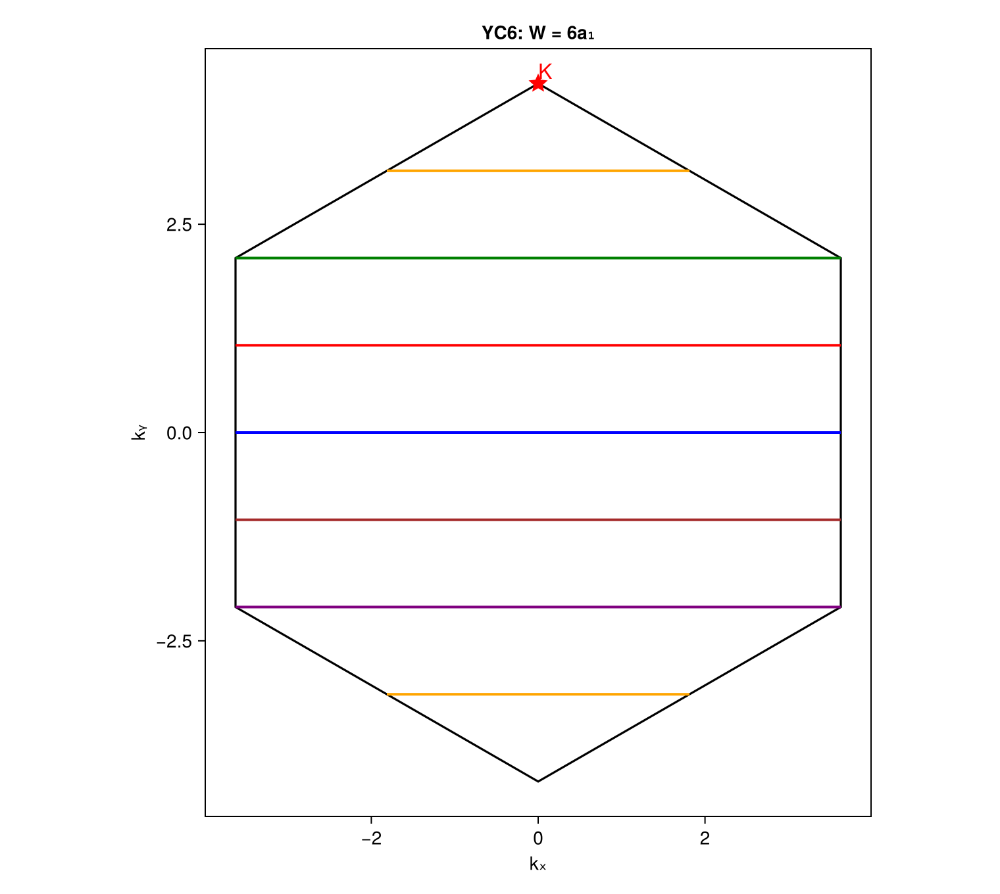
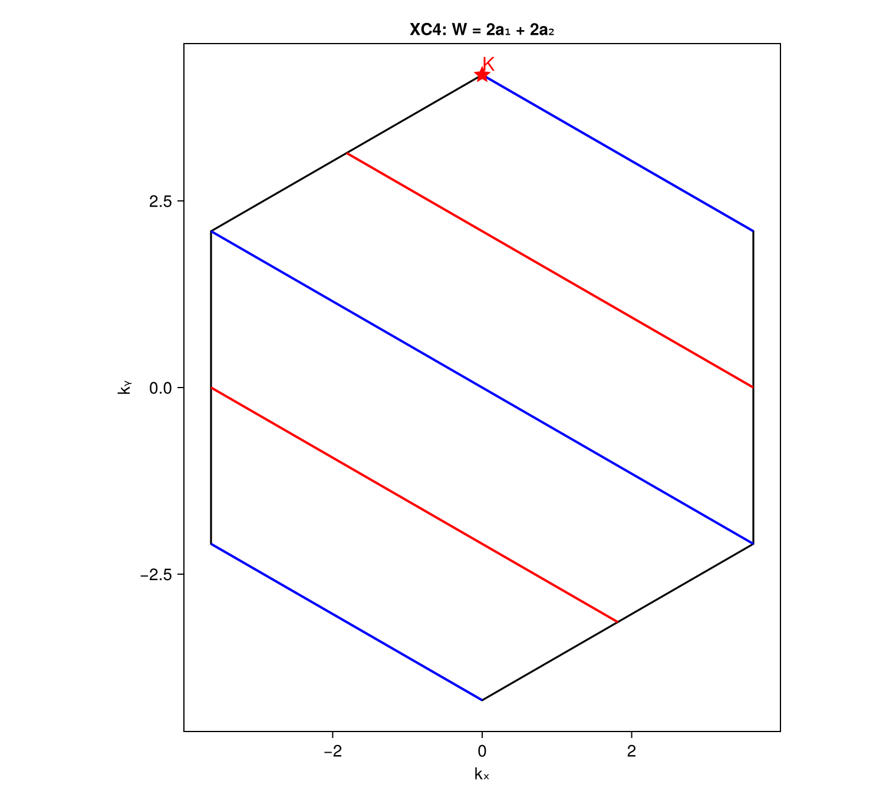
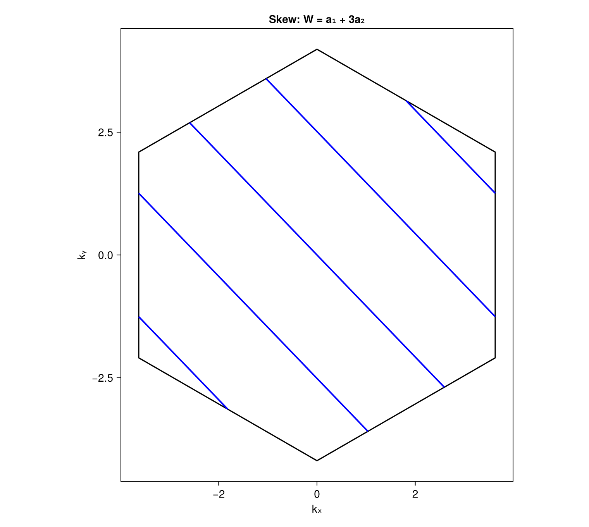
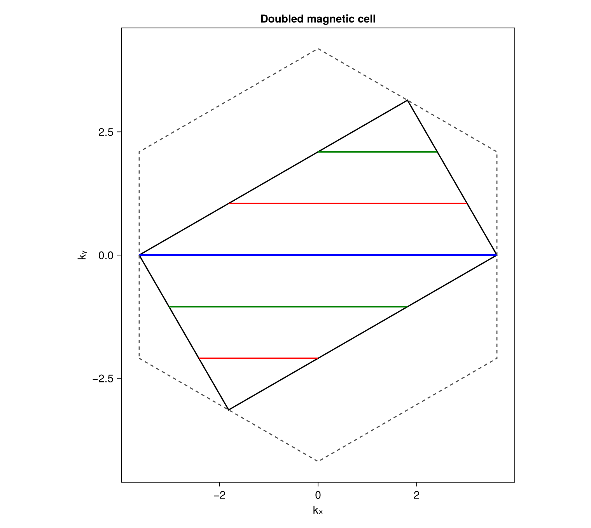
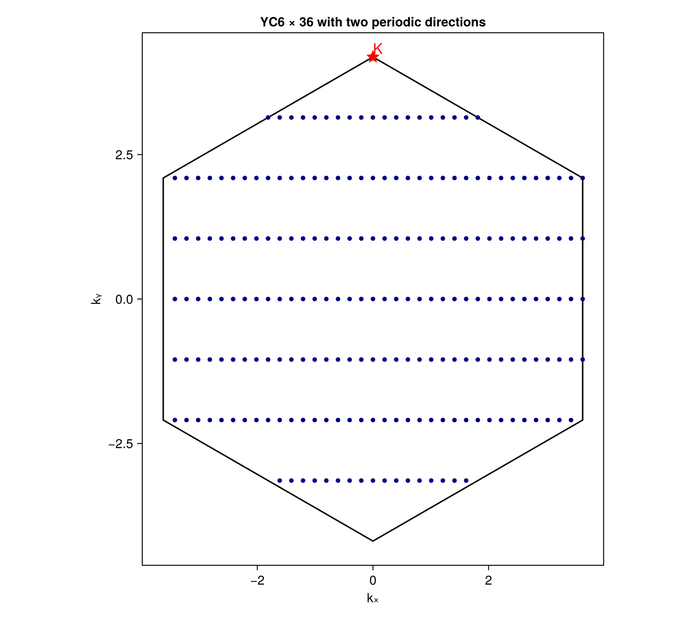

# Momentum Cuts on Cylinders and Periodic Clusters

This tutorial shows how to construct the first Brillouin zone (BZ), generate the
momentum lines allowed by a cylinder, distinguish independent sectors from folded
line segments, include skew wrapping and twisted boundaries, use an enlarged
magnetic cell, and enumerate discrete momenta when two directions are periodic.

The examples use a triangular lattice with

```math
\mathbf a_1=(0,1),\qquad
\mathbf a_2=\left(\frac{\sqrt3}{2},\frac12\right).
```

A YC6 cylinder has wrapping vector \(\mathbf W=6\mathbf a_1=(0,6)\). A 6×36
cluster additionally uses \(\mathbf T=36\mathbf a_2\) when the second direction
is made periodic.

## 1. Geometry and Boundary Conditions

A two-dimensional Bravais cell is specified by its real-space primitive vectors.
The reciprocal vectors are computed from

```math
\mathbf b_i\cdot\mathbf a_j=2\pi\delta_{ij},
\qquad B=2\pi A^{-T},
```

where the columns of \(A\) and \(B\) are the real- and reciprocal-space primitive
vectors. A momentum is written as

```math
\mathbf k=\kappa_1\mathbf b_1+\kappa_2\mathbf b_2.
```

The dimensionless coordinates \((\kappa_1,\kappa_2)\) are defined modulo integers.
For a wrapping vector

```math
\mathbf W=L_1\mathbf a_1+L_2\mathbf a_2
```

and boundary convention

```math
\psi(\mathbf r+\mathbf W)=e^{i\Phi}\psi(\mathbf r),
```

the allowed momenta satisfy

```math
L_1\kappa_1+L_2\kappa_2
=\ell+\frac{\Phi}{2\pi},\qquad \ell\in\mathbb Z.
```

One compact direction leaves continuous lines in the two-dimensional BZ. A second
independent compact direction adds another quantization condition, and the two
line families intersect at discrete points.

### Wrapping Coefficients Are Not Cartesian Coordinates

`TwistedTranslation((L1, L2))` expects integer coefficients in the Bravais basis,
not a Cartesian displacement. For the present lattice,

```julia
TwistedTranslation((6, 0))  # W = (0, 6) in Cartesian coordinates
```

because \(6\mathbf a_1=(0,6)\). By contrast, the Cartesian vector \([0,6]\) must
not be entered as `(0, 6)` unless the intended wrapping vector is
\(6\mathbf a_2=(3\sqrt3,3)\).

To convert a Cartesian wrapping vector, solve \(A\mathbf n=\mathbf W\) and check
that \(\mathbf n\) is integer. A cylinder cannot close cleanly on the infinite
Bravais lattice if the wrapping displacement is not a lattice translation.

## 2. Load the Package and Define the Cell

The geometry routines have no plotting dependency. Load `CairoMakie` only when
figures are needed:

```julia
using DynamicalCorrelators
using CairoMakie

a1 = [0.0, 1.0]
a2 = [sqrt(3) / 2, 0.5]
cell = BravaisCell2D(a1, a2)
```

`cell.A` and `cell.B` contain the real- and reciprocal-space vectors as columns.
The first BZ is computed as the Wigner–Seitz cell of the reciprocal lattice:

```julia
bz_vertices = brillouin_zone(cell)
```

The vertices are returned in counterclockwise order in Cartesian momentum
coordinates.

## 3. YC6: Six Sectors and Seven Visible Segments

Define the cylinder and compute its independent lines and folded BZ segments:

```julia
W = TwistedTranslation((6, 0))
yc6 = MomentumGeometry(cell, W)

cuts = allowed_cuts(yc6)
segments = bz_segments(yc6)

length(cuts)     # 6
length(segments) # 7
```

For \(\mathbf W=6\mathbf a_1\), the quantization condition is

```math
6\kappa_1=\ell.
```

Six independent representatives are

```math
\kappa_1=\frac p6,\qquad p=0,1,\ldots,5,
```

with continuous \(\kappa_2\). The default colors follow this sector order:

| Sector | \(\kappa_1\) | Default color |
|---:|---:|---|
| 0 | \(0\) | blue |
| 1 | \(1/6\) | red |
| 2 | \(1/3\) | green |
| 3 | \(1/2\) | orange |
| 4 | \(2/3\) | purple |
| 5 | \(5/6\) | brown |

There are seven visible segments because the \(p=3\) line appears as two orange
segments after folding into the first BZ. These are not two independent sectors.
Every `MomentumSegment` retains its parent `sector`, and all segments from one
sector use the same color. The black hexagon is only the BZ boundary.

Plot the zone, cuts, and a high-symmetry point:

```julia
K = [2 / 3, 1 / 3]  # fractional reciprocal coordinates

fig = momentum_plot(yc6;
    markers = Dict(:K => K),
    title = "YC6: W = 6a₁",
)
save("yc6_cuts.png", fig)
```



For this \(K\) point,

```math
6q_1=6\times\frac23=4\in\mathbb Z,
```

so it lies on the \(p=4\) cut. This can also be checked directly:

```julia
is_allowed(yc6, K)          # true
nearest_cut(yc6, K).cut.sector # 4
nearest_cut(yc6, K).distance   # approximately zero
```

Background grid lines are disabled by default. Use `tiled=true` to display a
3×3 tiling of BZs and inspect how folded segments continue across zone boundaries.

## 4. YC and XC Are Geometry Shorthands, Separate from the Algorithm

The program does not branch on names such as YC or XC. It only uses the actual
wrapping vector. Changing coordinate conventions does not change the physical
answer if the wrapping vector is transformed consistently.

For example, an XC4 geometry in the present basis can be defined by

```math
\mathbf W=2\mathbf a_1+2\mathbf a_2.
```

Its condition is

```math
2(\kappa_1+\kappa_2)=\ell.
```

At \(K=(2/3,1/3)\),

```math
2(q_1+q_2)=2\in\mathbb Z,
```

so XC4 can resolve this point exactly:

```julia
xc4 = MomentumGeometry(cell, TwistedTranslation((2, 2)))

length(allowed_cuts(xc4)) # 2
is_allowed(xc4, K)        # true

fig = momentum_plot(xc4; markers=Dict(:K => K), title="XC4")
```



In contrast, YC4 has \(\mathbf W=4\mathbf a_1\), and

```math
4q_1=\frac83\notin\mathbb Z.
```

Its structure-factor peak associated with 120° order can therefore occur only at
the closest allowed momentum, not exactly at the two-dimensional \(K\) point.
This illustrates why a circumference label such as `L=4` is insufficient without
the actual wrapping vector.

## 5. Skew Wrapping Changes Direction and Sector Count

A skew cylinder can have any nonzero integer wrapping coefficients. For example,

```julia
skew = MomentumGeometry(cell, TwistedTranslation((1, 3)))
cuts = allowed_cuts(skew)
segments = bz_segments(skew)

length(cuts)     # 1
length(segments) # greater than one
```

Here

```math
\mathbf W=\mathbf a_1+3\mathbf a_2,
\qquad
\kappa_1+3\kappa_2=\ell.
```

Since \(\gcd(1,3)=1\), there is only one independent sector. Its representative
line can be chosen as \(\kappa_1+3\kappa_2=0\). The multiple blue segments in the
first BZ all belong to this single sector.



The line direction differs from YC6 because allowed lines are perpendicular to
the actual real-space wrapping vector. This is not a boundary twist: skew
wrapping changes the wrapping vector, whereas a twist changes only the phase on
the right-hand side.

More generally, with

```math
g=\gcd(L_1,L_2),\qquad (n_1,n_2)=(L_1/g,L_2/g),
```

independent representatives can be written as

```math
n_1\kappa_1+n_2\kappa_2
=\frac{p+\Phi/(2\pi)}{g},\qquad p=0,\ldots,g-1.
```

## 6. Twisted Boundaries and Flux

The boundary phase translates the cuts without rotating them. For YC6,

```math
6\kappa_1=\ell+\frac{\Phi}{2\pi},
\qquad
\kappa_1=\frac{\ell+\Phi/(2\pi)}6.
```

Periodic and antiperiodic boundaries are therefore

```julia
pbc  = MomentumGeometry(cell, TwistedTranslation((6, 0); phase=0.0))
apbc = MomentumGeometry(cell, TwistedTranslation((6, 0); phase=pi))
```

The antiperiodic cuts are shifted by \(1/12\), half the periodic line spacing.

For a spin flux \(\theta\) in a spin-1/2 electronic problem, the two spin species
can be assigned opposite phases:

```julia
θ = 0.73
up   = MomentumGeometry(cell, TwistedTranslation((6, 0); phase= θ / 2))
down = MomentumGeometry(cell, TwistedTranslation((6, 0); phase=-θ / 2))
```

The spin-up and spin-down cuts move in opposite directions. In this convention,
\(\theta=2\pi\) gives antiperiodic single-electron boundaries, while
\(\theta=4\pi\) restores the original cuts. External and internal gauge phases
can be added in `phase`.

## 7. Enlarged or Magnetic Unit Cells

An enlarged cell is defined by an integer transform \(S\):

```math
A_{\mathrm m}=A_{\mathrm p}S,
\qquad
B_{\mathrm m}=B_{\mathrm p}S^{-T}.
```

Its columns contain the enlarged-cell vectors in parent-cell coordinates. For
example,

```julia
S = [2 0;
     0 1]
magnetic_cell = Supercell2D(cell, S)
```

means

```math
\mathbf a_{\mathrm m,1}=2\mathbf a_1,
\qquad
\mathbf a_{\mathrm m,2}=\mathbf a_2.
```

The real-space cell area is doubled and the magnetic BZ area is halved.
Wrapping vectors are still entered in parent-cell coefficients:

```julia
magnetic = MomentumGeometry(magnetic_cell, TwistedTranslation((6, 0)))
cuts = allowed_cuts(magnetic) # 3 sectors
```

The physical wrapping vector is \(6\mathbf a_1=3\mathbf a_{\mathrm m,1}\), so the
enlarged cell has three independent circumferential translations. If a wrapping
vector is not an integer translation of the enlarged cell, computing cuts or
points throws an error rather than silently rounding the coefficients.

Plot the magnetic BZ with the parent BZ overlaid:

```julia
fig = momentum_plot(magnetic;
    overlay_parent=true,
    title="Doubled magnetic cell",
)
```



The solid polygon is the magnetic BZ and the dashed hexagon is the parent BZ.
To clip the same physical lines against the parent BZ instead, use

```julia
fig = momentum_plot(magnetic; space=:parent)
```

Fractional momenta are interpreted in parent coordinates by default. Use
`space=:magnetic` when supplying magnetic-cell coordinates, or
`space=:cartesian` for a Cartesian momentum.

A magnetic supercell is needed for a mean-field ansatz with an enlarged magnetic
unit cell. Physical spin correlations are still commonly represented in the
original lattice BZ; the two representations should not be conflated.

## 8. Two Periodic Directions: Unique Discrete Points

Add a second independent wrapping vector to quantize both directions:

```julia
W = TwistedTranslation((6, 0))
T = TwistedTranslation((0, 36))
periodic = MomentumGeometry(cell, W, T)

points = allowed_points(periodic)
length(points) # 216
```

The two conditions are

```math
6\kappa_1=\ell+\frac{\Phi_W}{2\pi},
\qquad
36\kappa_2=m+\frac{\Phi_T}{2\pi}.
```

For zero twists, the allowed grid is simply

```math
\kappa_1=\frac{\ell}{6},
\qquad
\kappa_2=\frac{m}{36}.
```

The implementation enumerates a finite integer domain, folds equivalent momenta,
removes duplicates, and verifies that the number of points equals

```math
N=\left|\det
\begin{pmatrix}
L_1&L_2\\
M_1&M_2
\end{pmatrix}\right|.
```

Each `MomentumPoint` contains:

- `fractional`: coordinates in the working cell, folded to \([0,1)^2\);
- `parent_fractional`: coordinates in the parent Bravais basis;
- `cartesian`: the momentum folded into the selected first BZ;
- `sectors`: the two compact-direction sector labels.

Plot the points with

```julia
fig = momentum_plot(periodic; markers=Dict(:K => K))
```



The two wrapping vectors must be linearly independent. For an open cylinder
length, there is no second Bloch quantization condition: do not replace the open
direction by \(k_x=2\pi m/L_x\). The length then controls correlation distance
and momentum resolution rather than supplying exact discrete Bloch points.

## 9. Parallelogram Patches and Rectangular Cylinder Cells

The real-space picture and the momentum quantization are related but distinct.
For the primitive vectors used here,

```math
\mathbf W=L\mathbf a_1=(0,L)
```

is vertical. A rectangular cylinder cell can be constructed with the horizontal
lattice translation

```math
\mathbf t=2\mathbf a_2-\mathbf a_1=(\sqrt3,0),
```

which satisfies \(\mathbf W\cdot\mathbf t=0\). The rectangle spanned by
\(\mathbf W\) and \(\mathbf t\) contains \(2L\) primitive lattice sites. It is a
rectangular supercell of the same triangular lattice, not a square Bravais
lattice.

A patch generated by positive multiples of \(\mathbf a_1\) and \(\mathbf a_2\)
is instead a parallelogram. Both constructions can describe the same bulk
cylinder when the wrapping vector and bonds are the same. Consequently, they
give the same allowed momentum lines.

Finite open clusters require more care: slanted and straight end cuts can contain
different sites and boundary bonds, so their energies and edge correlations need
not be identical. With two periodic directions, the second wrapping vector must
also be compared directly; different second identifications can produce different
discrete momentum sets.

## 10. Practical Checklist

1. Define `BravaisCell2D` using real-space primitive vectors.
2. Convert every wrapping displacement to integer Bravais coefficients.
3. Use one `TwistedTranslation` for a cylinder and two for a periodic cluster.
4. Use `allowed_cuts` for independent sectors and `bz_segments` for folded lines.
5. Check a target order wavevector with `is_allowed` or `nearest_cut`.
6. Add boundary phases for twists or flux; do not confuse them with skew wrapping.
7. Use `Supercell2D` for an enlarged mean-field or magnetic cell and verify that
   the wrapping vector remains a legal enlarged-cell translation.
8. Use `allowed_points` only for two independent periodic directions.
9. Use `momentum_plot` after loading `CairoMakie`; load only the core package for
   numerical geometry without plotting.
